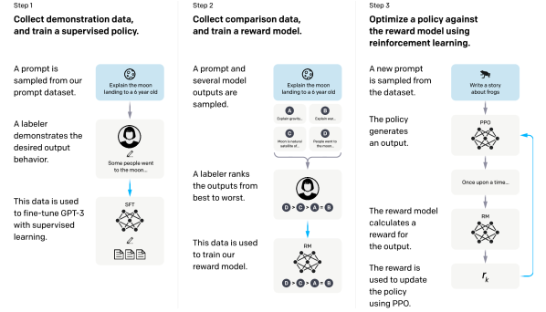
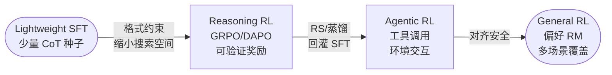

# 1.2 两大范式：RLHF、DPO 与 RLVR

!!! abstract "本节摘要"
    后训练的核心问题只有一个：**奖励从哪里来**。本节把 RLHF（人类偏好训 RM、再用 PPO 优化）、DPO（把 RLHF 目标改写成离线监督损失）、RLVR（可验证奖励）放在同一条坐标上，给出流程、关键公式、对比表与各自的失效方式，最后落到 2026 年"轻量 SFT + 重 RL"的收敛流水线。

RLHF 证明了后训练的杠杆：InstructGPT（arXiv:2203.02155）让 1.3B 模型在人类评估中胜过 175B 的 GPT-3 基座。RLVR 把杠杆搬到可验证任务上：DeepSeek-R1-Zero 在 AIME 2024 上从 V3-Base 的 39.2% 提到 71.0%。两者之间是 DPO 这条"去 RL 化"的分支。

## 一、RLHF：从人类反馈学习

核心洞察是：人类写不出完美回答，但很擅长比较两个回答。RLHF 把"比较"变成可优化的标量奖励，再用 RL 更新策略，流程分三段：

| 阶段 | 做什么 | 训练信号 |
|---|---|---|
| ① SFT | 用人工示范微调基座，建立对话格式与指令跟随 | 交叉熵 |
| ② RM | 用成对比较训练奖励模型 $r_\varphi$，Bradley-Terry 假设 $P(y_w \succ y_l)=\sigma\big(r_\varphi(x,y_w)-r_\varphi(x,y_l)\big)$ | 成对排序损失 |
| ③ RL | 以 $r_\varphi$ 为奖励、在 KL 约束下用 PPO 更新策略 | 策略梯度 |

<figure markdown="span">
  { width="100%" }
  <figcaption>InstructGPT 的 RLHF 经典三阶段流程：SFT → 奖励模型训练 → PPO 强化学习（图源：arXiv:2203.02155）</figcaption>
</figure>

### RL 优化目标

$$
\max_{\pi_\theta} \; \mathbb{E}_{x \sim \mathcal{D},\, y \sim \pi_\theta(\cdot|x)} \left[ r_\varphi(x, y) \right] - \beta \cdot \mathrm{KL}\left[\pi_\theta(\cdot|x) \,\|\, \pi_{\text{ref}}(\cdot|x)\right]
$$

KL 惩罚项的作用是防止策略为拿高分而偏离参考模型的语言分布——它是 reward hacking 的第一道闸门；$\beta$ 越大，策略越贴住 $\pi_{\text{ref}}$。PPO 的裁剪细节见 [2.1 PPO](../ch2/2.1-ppo.md)。

### 奖励模型的四个已知问题

| 问题 | 表现 | 应对策略 |
|------|------|----------|
| **Reward Hacking** | 模型学会"讨好" RM 而非真正提升质量 | KL 惩罚、多 RM 集成 (WARM) |
| **长度偏差** | RM 倾向于给更长回答更高分 | 长度归一化、显式长度惩罚 |
| **泛化不足** | RM 在训练域外不可靠 | 迭代式 RM 更新 (LLaMA 3.1 的 6 轮迭代) |
| **分布偏移** | 策略更新后 RM 面对的输入分布变化 | 在线 RM 更新、RLVR 绕过 RM |

四个问题的共同根源是：奖励是**学出来的近似**，策略有足够多的优化步数去找它的漏洞。这一点决定了后两个范式各自的设计取舍。

??? info "📖 为什么 SFT 仍是第一步"
    SFT 教两件事：输出格式（问题—回答的对话结构，而非无限续写）与基本能力（遵循指令、调用工具）。跳过 SFT 直接 RL 会遇到格式混乱——R1-Zero 的语言混杂与可读性下降就是代价。2026 的修正只是"轻量化"：SFT 提供格式种子，不负责教会推理。

## 二、离线偏好优化：DPO

RLHF 的第 ③ 段要同时挂策略、参考模型、RM 与 Critic 四个网络，训练不稳且对超参敏感。DPO（Rafailov et al., 2023，arXiv:2305.18290）的出发点是：KL 约束下 RLHF 的最优解有闭式形式 $\pi^*(y|x)\propto \pi_{\text{ref}}(y|x)\exp\!\big(r(x,y)/\beta\big)$；反解即得隐含奖励

$$
r(x,y)=\beta \log\frac{\pi^*(y|x)}{\pi_{\text{ref}}(y|x)}+\beta\log Z(x)
$$

既然最优策略"就是"奖励模型，就不必单独训 RM，也不必在线采样——偏好对齐退化成一个离线监督问题：

$$
\mathcal{L}_{\text{DPO}}(\theta) = -\mathbb{E}_{(x, y_w, y_l) \sim \mathcal{D}} \left[ \log \sigma\!\left( \beta \log \frac{\pi_\theta(y_w|x)}{\pi_{\text{ref}}(y_w|x)} - \beta \log \frac{\pi_\theta(y_l|x)}{\pi_{\text{ref}}(y_l|x)} \right) \right]
$$

损失直接拉大 $y_w$ 与 $y_l$ 相对参考模型的对数概率比之差；$\beta$ 同时控制偏离 $\pi_{\text{ref}}$ 的强度与对"已经拉对"样本的降权速度。与 RLHF 的关系是：DPO 不是新目标，而是同一个 KL 正则目标在 Bradley-Terry 偏好模型下的**离线重参数化**——它把"先学奖励、再在线 RL"换成"直接在偏好对上做监督"，两者共享同一个最优解，代价是数据离线。

代价在数据：偏好集覆盖不到的探索空间 DPO 学不到，而在线 RL 可以在训练中重新采样、持续利用 verifier 或 RM 的新信号。因此 DPO 的实际定位已经清晰——LLaMA 3.1 的对比认为它在通用对齐上可优于 PPO（该结论有争议，DeepSeek/ByteDance 的经验相反）；在数学/代码推理上，在线 RL（GRPO/DAPO/VAPO）明显更强；LLaMA 4 已把 DPO 降为"轻量后处理"步骤，核心推理提升交给 Online RL。KTO/ORPO/IPO 等变体见综述 arXiv:2503.06072。

## 三、RLVR：可验证奖励

RLVR（RL with Verifiable Rewards）由 DeepSeek-R1（arXiv:2501.12948）确立：对答案可判定的任务，直接用规则判定作为奖励，**完全绕过 RM**。R1-Zero 只用了两类规则奖励——答案正确性 + 格式合规（推理过程包在思考标签内）——就把 AIME 2024 pass@1 做到 71.0%，并在训练中自发出现自我验证与反思行为。

$$
R(\hat{y}, y) = \begin{cases} +1, & \text{is\_equivalent}(\hat{y}, y) \\ -1, & \text{otherwise} \end{cases}
$$

### RLHF vs RLVR

| 维度 | RLHF | RLVR |
|------|------|------|
| **奖励来源** | 训练的 RM（近似人类偏好） | 规则判定（答案匹配、代码测试通过） |
| **Reward Hacking 风险** | 高（RM 有漏洞） | **极低**（答案对就是对） |
| **适用任务** | 通用（对话、创作、对齐） | **仅限有确定答案的任务**（数学、代码、逻辑） |
| **数据需求** | 需要人类偏好标注 | 只需 (题目, 标准答案) 对 |
| **核心算法** | PPO + RM | GRPO, DAPO, VAPO 等 |
| **代表模型** | InstructGPT, LLaMA 2, Claude | DeepSeek-R1, Qwen3, Seed1.5-Thinking |

### 为什么 RLVR 在推理任务上取得突破？

1. **零 Reward Hacking**：数学题答案不存在"讨好"的空间，1+1=2 就是 2。
2. **信号无噪但稀疏**：对/错的二元反馈没有标注噪声；稀疏性靠组内归一化的 GRPO 与动态采样补足，见 [2.2 GRPO](../ch2/2.2-grpo.md)。
3. **可大规模扩展**：题目与标准答案可程序化生成，不需要人类标注——这是 RL 能把算力吃进去的前提。
4. **涌现能力**：R1-Zero 的自我反思、纠错不是 SFT 教的，而是在可验证目标下被 RL 自己长出来的。

代价是覆盖面：RLVR 只在有确定答案的域成立，且把"验证器可靠"当成了新假设——验证器本身如何失效、怎么检查，见 [1.4 奖励设计](./1.4-reward-lineage.md)。

## 四、2026 的收敛

各家实现差异很大，但流水线在 2025–2026 收敛到"轻量 SFT + 重 RL"：SFT 不再教推理，只提供格式约束与最小可探索种子（R1 用数千条、Qwen3 用 3,995 条查询就把 RL 拉起来）；推理能力交给可验证奖励的大规模 RL，Agentic RL 接上工具与环境，最后一小段 General RL 管通用对话与安全。

2026 年的新变量在奖励侧：DeepSeek V4 让 actor 兼任 GRM（rubric 引导的自我评判，不再单独训标量 RM），GLM-5.3 把 verifier 本身当成被测对象做三检——这条谱系见 [1.4 奖励设计](./1.4-reward-lineage.md)，阶段编排与合并方式见 [1.3 流程范式](./1.3-pipeline-paradigms.md)。

一句话：RLHF 负责"没有标准答案"的通用与安全，RLVR 负责"有标准答案"的推理与 agent，DPO 退到两者之间的轻量对齐位；2026 正在用 actor-as-GRM 把前者的 RM 换成生成式评判。
