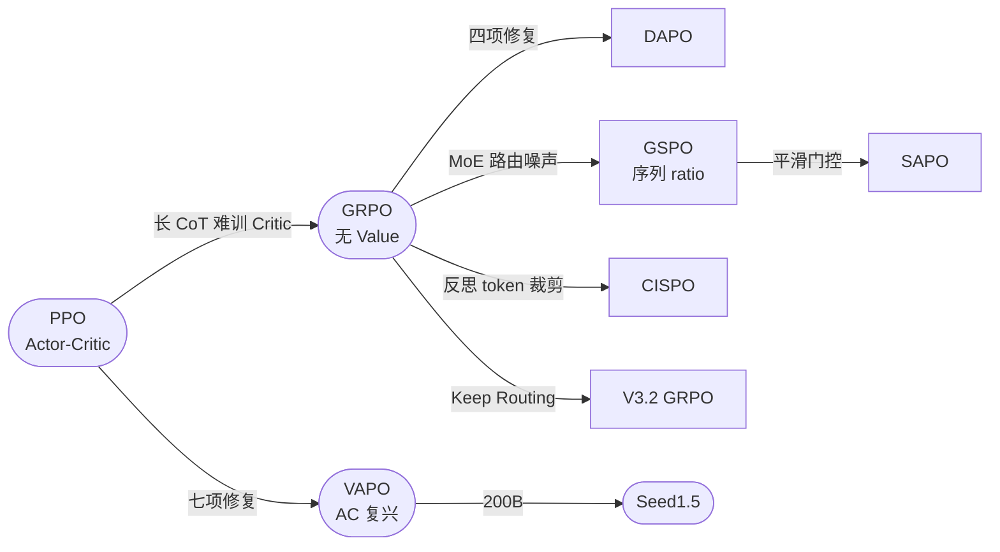

# 2.8 跨模型训练经验总结

!!! abstract "本节摘要"
    横向对比 DeepSeek、Kimi、Qwen、MiniMax、GLM、Seed 等 9 个模型系列的后训练 Pipeline 与 RL 算法选择，梳理从 PPO 到 GRPO 再到 GSPO/SAPO 的算法演进脉络，归纳奖励设计差异，并提炼出十条可复现的共性训练经验与六大趋势展望。

!!! note "2026-11 更新"
    本节主体保留 2025 年的对比口径（当时只有 9 个系列）。2026 年的新模型（DeepSeek-V4、Kimi K3、GLM-5.3、MiniMax M3、LongCat、Ling/Ring）带来**三个新维度**：合并方式、一致性手段、异步策略——见下方「2026 年的三个新维度」。机制层面的横向对比已拆到 [2.2 训练流程](themes/02-pipeline-paradigms.md)、[2.5 基础设施](themes/05-infra-consistency.md) 两页。

## 后训练 Pipeline 对比

| 模型 | 阶段数 | Pipeline 结构 | RL 算法 | Value 网络 |
|------|--------|-------------|---------|-----------|
| DeepSeek-R1 | 4 | Cold SFT → Reasoning RL → Rej.Sampling SFT → General RL | **GRPO** | 无 |
| DeepSeek-V3.2 | 3 | Specialist Distillation → Mixed RL → Speciale (推理变体) | **GRPO**（4 项稳定化） | 无 |
| Kimi K2 | ~3 | SFT → Agentic RL (RLVR + Self-Critique) | Policy Mirror Descent | 无 |
| Kimi K2.5 | ~3 | SFT → RL + Toggle + PARL | Policy Mirror Descent | 无 |
| Qwen3 | 4 | Cold SFT → Reasoning RL → Mode Fusion SFT → General RL | **GRPO** | 无 |
| MiniMax-01 | 5 | Short SFT → Long SFT → Short DPO → Long DPO → RL | GRPO (修改版) | 无 |
| MiniMax-M1 | 3 | CPT → SFT → RL | **CISPO** | 无 |
| GLM-5 | 5 | SFT → Reasoning RL → Agentic RL → General RL → Distillation | GRPO + IcePop | 无 |
| Seed/VAPO | 2-3 | (Cold SFT →) RL | **VAPO (PPO改)** | **有** |

## 2026 年的三个新维度

2025 年的对比只看"阶段数 + 算法 + 有没有 Value 网络"。2026 年这三列已经不足以区分——所有人在算法上都趋同，差异转移到了别处：

| 模型 | 合并方式 | 一致性手段 | 异步策略 |
|---|---|---|---|
| **DeepSeek-V4 / V4.1** | 多教师全词表 OPD（>10 → >40 教师） | 未公开 | 异步 RL |
| **Kimi K3** | 9 专家（3 域 × 3 effort）+ **MOPD** | **全流程 QAT**（MXFP4/MXFP8） | partial rollout + 微虚机 |
| **GLM-5 / 5.3** | 跨阶段蒸馏 + 多教师 OPD | **TITO** + 确定性 top-k + 双侧 IS | 全异步（Slime） |
| **MiniMax M2.5** | 无（混合域训练） | 前缀树合并 + PD 分离 | Forge（Windowed FIFO） |
| **LongCat 2.0 / 2.5** | 多教师在线蒸馏 + MOPD | W4A4 数值一致 | DORA（load ratio 63%） |
| **Ling / Ring 2.6** | 无（迁移预训练 + LPO） | FP8 + LM head FP32 | ASystem（partial + 有界 stale） |
| **Qwen3.5 / 4-Max** | 跨模态 OPD（Omni） | TRACE（FP4 对齐） | QwenGyre（弹性 GPU） |

**读法**：算法列（GRPO/GSPO/SAPO）已经不能解释差异了——**合并方式决定能力上限，一致性手段决定能不能跑起来，异步策略决定成本**。这三列才是 2026 年的胜负手。

## RL 算法演进脉络

边注：DAPO 约 +20 AIME；GRPO 与 PPO 分支动机见下列观察。

**关键观察**：

1. **GRPO 的"偶然成功"**：GRPO 在 Dense 模型上 work 是因为 token-level ratio 的噪声可控；在 MoE 上暴露了根本问题（GSPO/CISPO 独立发现）
2. **Actor-Critic 的"冤案"**：PPO 在长 CoT 上的失败不是范式问题，而是 Critic 实现问题（VAPO 证明）
3. **序列级方法的趋势**：GSPO 和 CISPO 同时独立提出序列级 importance ratio，说明这是一个被社区广泛感知到但尚未统一解决的痛点
4. **从硬裁剪到平滑门控**：SAPO 在 GSPO 基础上用 sigmoid 门控替代硬裁剪，解决了大规模训练中的 collapse 问题，代表了 MoE RL 算法的最新演进
5. **MoE 稳定化的多条路径**：V3.2 的 Keep Routing（固定 MoE 路由）和 GSPO/SAPO 的序列级方法从不同角度解决同一问题 -- MoE 专家路由的不一致性

## 奖励设计对比

| 模型 | 奖励来源 | 维度 | 特色 |
|------|---------|------|------|
| DeepSeek-R1 | 规则 RM + 偏好 RM | 2 | 偏好 RM 限时使用（防 reward hacking） |
| DeepSeek-V3.2 | 规则 RM + 域特定 KL | 多域 | 数学弱 KL / 其他域强 KL，**域特定调节** |
| Kimi K1.5 | 二元结果 + **CoT RM (98.5%)** | 1 | RM 自身也"思考" |
| Kimi K2 | RLVR + **Self-Critique Rubric** | 3 类 rubric | 闭环 critic 优化 |
| Qwen2.5 | **6 维度独立 RM** | 6 | 分维度构造 DPO 偏好对 |
| MiniMax-01 | **4 维度 RM** | 4 | 长-短分离评估 |
| GLM-5 | 规则 RM + 模型 RM | 多维 | Cross-Stage teacher 信号 |
| Seed/VAPO | MC return + 规则 RM | 1 | 用于 Critic 预训练 |

## 十条共性训练经验

基于以上所有系列的分析，提炼以下**可复现的共性经验**：

!!! success "经验 1：Cold-start SFT 宜少不宜多"
    DeepSeek-R1 用"数千条"、Qwen3 用 ~3,995 queries 的 RL 就提升 +15 AIME。过多 SFT 数据会缩小 RL 探索空间（Seed1.5 的 RFT 反面验证）。Cold-start SFT 的目标是**提供格式约束和最小的推理模式种子**，而非教会模型推理。

!!! success "经验 2：RL 的关键是查询质量而非数量"
    Qwen2.5 的方差优先采样、DAPO 的 Dynamic Sampling、DeepSeek-R1 的课程策略 -- 核心思想一致：**让模型处于"有时能、有时不能"的边界上的查询贡献最大梯度**。

!!! success "经验 3：蒸馏是小模型的最优路径"
    DeepSeek-R1 蒸馏 >> 直接 RL（+25 AIME）、Qwen3 蒸馏 ~1/10 GPU、K2.5 的 Agent Swarm 用冻结子 Agent 辅助训练 -- **大模型做 RL，小模型做蒸馏 + 少量 RL** 是性价比最高的路线。

!!! success "经验 4：偏好 RM 必须限时使用"
    DeepSeek-R1 仅在最后 400/1700 步使用偏好 RM，更长暴露导致 reward hacking。这与 OpenAI 的 CoT-hidden-from-RM 策略异曲同工 -- **RM 越强，被利用的风险越高**。

!!! success "经验 5：MoE 模型需要专门的 RL 稳定化"
    GSPO（Qwen）和 CISPO（MiniMax）独立发现 token-level ratio 在 MoE 上不稳定；SAPO 进一步用平滑门控替代硬裁剪解决了大规模训练 collapse；V3.2 的 Keep Routing 则从另一角度固定 MoE 路由来消除不一致。随着 MoE 成为主流架构，这些方法（序列级方法 / 平滑门控 / 路由固定）应被视为必备工具箱。

    **2026 修订**：这条经验的重心要后移——序列级 ratio 只是算法层补丁。R3（[2510.11370](https://arxiv.org/abs/2510.11370)，ICML 2026）证明**路由回放**的效果优于 GSPO/TIS；GLM-5 证明部分架构（DSA 的 k=2048 top-k）根本无法回放，只能靠**确定性算子 + 冻结子模块**；Kimi K3 用**全流程 QAT** 从根上消除训推差异。结论：**一致性优先于目标函数**。

!!! success "经验 6：长上下文后训练需要短-长分离"
    MiniMax-01 的 5 阶段 Pipeline 和 K1.5 的课程式上下文扩展（4K→32K→128K）说明：**直接在混合长短数据上训练会导致短数据主导梯度**。

!!! success "经验 7：Agentic RL 的基础设施比算法更重要"
    GLM-5 的 TITO（防 re-tokenization）、非确定性 top-k 修复、MiniMax Forge 的 Prefix Tree Merging（40x 加速）-- 这些"工程细节"对最终效果的影响可能超过算法选择。

!!! success "经验 8：Actor-Critic 并非已死"
    VAPO 在 AIME 上 60 vs DAPO 50，Seed1.5 在 200B 规模上 VAPO 仍优 6-10 分。DeepSeek-R1 放弃 Critic 是因为 671B 的 Critic 太贵，**不是因为 Critic 没用**。

    **2026 修订**：Critic 不是唯一解了。Progress Advantage（[2606.26080](https://arxiv.org/abs/2606.26080)）用策略/reference 的 log-prob ratio 精确恢复最优 advantage，SDPO（[2601.20802](https://arxiv.org/abs/2601.20802)）用特权上下文自蒸馏——两条路都**免 Critic** 拿到 token/step 级信号。所以准确说法是：**Critic 是最准的一条，但不是唯一一条**。详见 [1.14](../ch1/1.14-budget-and-dense-signal.md)。

!!! success "经验 9：Cross-Stage Distillation 解决遗忘"
    GLM-5 的阶段 5 证明：多阶段训练的遗忘问题可以通过在最终阶段蒸馏所有前序阶段的能力来解决。group size=1 + teacher gap 优势估计是关键技巧。

    **2026 修订**：跨阶段蒸馏只是"合并"的一种。更彻底的做法是**专家 + 合并**：DeepSeek V4（>10 → >40 教师，全词表 OPD）、Kimi K3（9 专家 + MOPD）、LongCat 2.0（多教师 + MOPD）。如果阶段之间是并列关系（数学/代码/安全），专家+合并优于串行蒸馏；如果是递进关系（推理→agent），串行蒸馏更省。详见 [1.16](../ch1/1.16-merging-opd-mopd.md)。

!!! success "经验 10：Thinking 模式应内置而非后加"
    Qwen3 的 Mode Fusion SFT、GLM-5 的三级 Thinking 控制、K1.5 的 long2short -- Thinking/Non-thinking 的灵活切换需要在 Post-Training Pipeline 中**作为独立阶段设计**，而非作为推理时的 prompt engineering。

## 趋势展望（2026-11 更新）

| 趋势 | 2026 的证据 | 判断 |
|------|------|------|
| **Agentic RL 成为主战场** | V4、K3、M3、GLM-5.3、LongCat-2.5 全部以 agent 为核心卖点 | 已兑现；竞争点转向"环境质量" |
| **后训练投资继续增长** | GLM-5.3 用**同基座**把 Terminal-Bench 3.0 从 4.6 做到 28.3 | 已兑现，且**后训练 scaling 远未见顶** |
| **模型辅助自身训练** | M2.7 吸收 30–50% 日常迭代；GLM-5.3 用 research agent 造环境 | 部分兑现；仍是"人设计、模型执行" |
| **多模态 RL 合并进主流程** | K2.5 的 zero-vision SFT、Qwen3.5-Omni 的跨模态 OPD | 已兑现；OPD 成为跨模态迁移工具 |
| **MoE RL 算法成熟化** | 算法趋同（GRPO 变体），差异转向**一致性**（R3/QAT/确定性算子） | **改写**：不是"算法成熟"，是"算法不再是瓶颈" |
| **架构-训练协同设计** | Qwen3.5 的 GDN+MoE、GLM-5.2 的 IndexShare、MiniMax 的 MSA | 已兑现；架构创新越来越依赖"训练侧能不能配合" |
| **（新增）环境飞轮** | EnvFactory、SPADE、AutoEnvScaling 报出 25× 有效环境率 | 取代"数据飞轮"成为 2026 的主叙事 |
| **（新增）预算分配成为一等问题** | Pilot-Commit 省 1.9–4.0× rollout、ReMix 30–450× | 同等算力下的收益主要来自"每一步花在哪" |
