# 3.1 技术演进与范式变迁

!!! abstract "本节摘要"
    回顾 Post-Training 从 2017 年 PPO 发布到 2026 年 Agentic RL 论文井喷的完整演进时间线，识别六个关键转折点，并总结从 SFT-Only 到 RLHF、RLVR、Agentic RL 的四代范式变迁及其背后的驱动力（人类标注成本、Reward Hacking、推理与 Agent 能力需求）。

!!! note "阅读说明"
    本章是基于前两章内容的宏观分析与个人思考。包含技术演进时间线、范式变迁分析、核心挑战梳理，以及对未来方向的主观判断。标注为「💭 个人观点」的部分代表作者的主观看法，仅供参考。

## 关键里程碑

```mermaid
timeline
    title Post-Training 技术演进时间线
    section 2017-2022 奠基
        2017.07 : PPO 发布 (Schulman et al.)
                : 奠定策略优化基础框架
        2022.03 : InstructGPT 发布 (OpenAI)
                : 确立 SFT → RM → RLHF 三阶段范式
                : 证明 1.3B RLHF > 175B Base
        2022.12 : Constitutional AI (Anthropic)
                : 提出 RLAIF, 用 AI 反馈替代人类反馈
    section 2023-2024 分化
        2023.05 : DPO 发布 (Stanford)
                : 绕过 RM, 直接从偏好数据优化策略
        2024.02 : DeepSeekMath → GRPO
                : 消除 Critic, Group Relative 优势
        2024.07 : LLaMA 3.1 (Meta)
                : 6 轮迭代训练, 工业级最详尽报告
        2024.12 : DeepSeek-V3 / Qwen2.5
                : R1 蒸馏 pipeline / 6 维 RM
    section 2025 RLVR 爆发
        2025.01 : DeepSeek-R1 ★★★
                : 纯 RL 推理涌现, RLVR 范式确立
        2025.03 : DAPO (ByteDance Seed)
                : 首个完全开源大规模 RL 系统
        2025.04 : VAPO / Seed1.5-Thinking
                : 回归 Value-Based, 修好 Critic
        2025.05 : Qwen3
                : Thinking Mode Fusion
        2025.06 : CISPO (MiniMax-M1)
                : 裁剪 IS 权重而非目标函数
        2025.07 : GSPO / Kimi K2
                : Sequence-Level + 3000 MCP 工具
        2025.11 : SAPO (Qwen Team)
                : Soft Gating 统一理论框架
    section 2026 Agentic RL
        2026.02 : GLM-5 (智谱)
                : 五阶段全能 pipeline
        2026.03 : Agentic RL 论文井喷
                : SeeUPO, EMPO², ARLArena
    section 2026 后训练新阶段
        2026.04 : DeepSeek-V4
                : 多教师 OPD + actor 兼任 GRM
        2026.06 : MiniMax M3 / MSA
                : 1M 上下文块稀疏注意力
        2026.06 : LongCat-2.0
                : 多教师在线蒸馏 + MOPD
        2026.07 : Kimi K3
                : 9 专家 + MOPD + 全流程 QAT
        2026.08 : GLM-5.3
                : 同基座纯后训练 scaling (TB3.0 4.6→28.3)
        2026.11 : LongCat-2.5 / Qwen4-Max
                : 1.6T 国产算力 / 2.4T-71B
```



## 时间线的几个关键转折

| 转折点 | 时间 | Before → After |
|--------|------|----------------|
| InstructGPT | 2022.03 | "更大更好" → "训练方式更重要" |
| DPO | 2023.05 | "必须在线 RL" → "离线也可以" |
| DeepSeek-R1 | 2025.01 | "RL 辅助 SFT" → "RL 是推理的核心引擎" |
| DAPO+VAPO | 2025.03-04 | "GRPO 就够了" → "工程细节决定性能" |
| GSPO+SAPO | 2025.07-11 | "Token-Level 优化" → "Sequence-Level 思维" |
| Agentic RL 论文潮 | 2026 Q1 | "单轮 RL" → "多轮/交互式 RL" |
| 专家+合并（OPD/MOPD） | 2026.04-07 | "一个模型多目标" → "多专家训练 + 在策略蒸馏合并" |
| 同基座后训练 scaling | 2026.08 | "换更大的基座" → "同一基座把后训练做深" |

## Post-Training 范式演变

### 四代范式

=== "第一代：SFT-Only (2020-2022)"

    ```
    Base Model → SFT → Deploy
    ```

    - **代表**: 早期的 Alpaca, Vicuna
    - **核心思路**: 用高质量对话数据直接微调
    - **局限**: 模型只会模仿，不会"判断好坏"

=== "第二代：RLHF (2022-2024)"

    ```
    Base → SFT → RM Training → PPO/DPO → Deploy
    ```

    - **代表**: InstructGPT, ChatGPT, Claude, LLaMA 2
    - **核心思路**: 用人类偏好训练奖励模型，再用 RL 优化
    - **突破**: 模型学会了"什么是更好的回答"
    - **局限**: RM 容易被 hack，pipeline 复杂，对推理提升有限

=== "第三代：RLVR + Reasoning RL (2025)"

    ```
    Base → Cold Start SFT → Reasoning RL (GRPO/DAPO/VAPO) → General RL → Deploy
    ```

    - **代表**: DeepSeek-R1, Qwen3, QwQ
    - **核心思路**: 用可验证的规则奖励（答案对错）直接训练推理能力
    - **突破**: 推理能力从 RL 中涌现，不再依赖标注数据
    - **局限**: 只适用于有确定答案的任务

=== "第四代：Agentic RL (2025-2026)"

    ```
    Base → SFT → Reasoning RL → Agentic RL → General RL → Deploy
    ```

    - **代表**: GLM-5, Kimi K2, 以及 2026 Q1 的研究论文
    - **核心思路**: 将 RL 扩展到多轮交互、工具使用、环境感知等复杂场景
    - **挑战**: 奖励信号更稀疏、信用分配更困难、探索空间更大

=== "第五代：专家+合并 (2026)"

    ```
    域1 SFT+RL → 专家1 ┐
    域2 SFT+RL → 专家2 ┼→ OPD/MOPD 合并 → Deploy
    域3 SFT+RL → 专家3 ┘
    ```

    - **代表**: DeepSeek-V4（>10 → >40 教师）、Kimi K3（9 专家 + MOPD）、LongCat-2.0、GLM-5 的跨阶段蒸馏
    - **核心思路**: 承认"一个模型同时精通所有域"不现实——先分别训专家，再用**在策略蒸馏**合并
    - **突破**: 绕开多目标干扰与能力遗忘；合并阶段用学生自己采样，避免 SFT 蒸馏的 exposure bias
    - **挑战**: 教师数量带来调度/显存/带宽成本；教师会把自身坏习惯蒸进学生；合并后通常不再继续 RL

### 范式演变的驱动力

| 驱动力 | 从 → 到 | 关键论文/事件 |
|--------|---------|--------------|
| **人类标注成本** | 人类偏好 → AI 偏好 → 规则奖励 | InstructGPT → CAI → DeepSeek-R1 |
| **Reward Hacking** | 神经网络 RM → 多维 RM → 规则 RM | InstructGPT → Qwen2.5 → DAPO |
| **推理能力需求** | 通用对齐 → 专项推理 RL | ChatGPT → R1 / QwQ |
| **Agent 能力需求** | 单轮生成 → 多轮交互 | GPT-4 → Kimi K2 / GLM-5 |
| **算法效率** | PPO (4 模型) → GRPO (3 模型) → DPO (无 RL) | 持续追求更简单高效的训练方式 |
