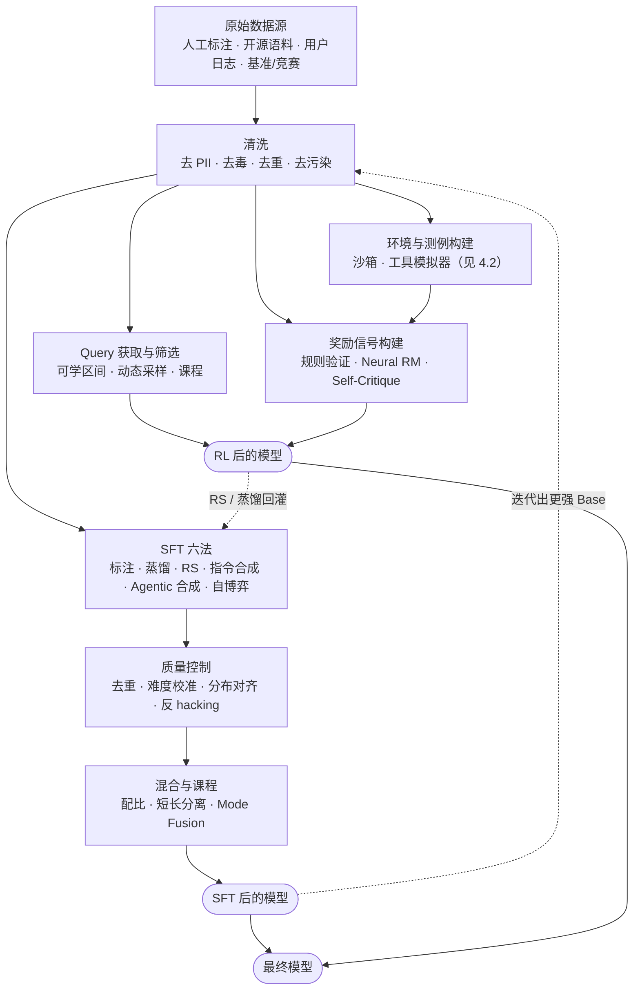
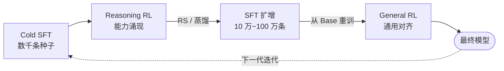

# 4.1 数据工程：SFT 六法 + RL 三维

!!! abstract "本节摘要"
    SFT 数据解决"模型怎么说话"，RL 数据解决"模型怎么变强"。本节把 SFT 数据来源归纳为六种方法，把 RL 数据工程拆成 Query / 奖励 / 环境三个维度，并给出质量控制、混合课程与 SFT–RL 闭环的可复用结论。环境合成单独成节，见 [4.2 环境工程](./4.2-environment.md)。

---

## 一、全景：两类数据，一条闭环

两类数据的差别不在量，而在**形态**：SFT 要 (query, answer) 对，RL 要的是"能反复采样的问题 + 可自动判分的信号 + 可执行的环境"。问题、信号、环境三者共同决定 RL 的上限。

## 二、SFT 六法

六种方法不是并列选项，而是按"质量 / 可扩展性"排成的一个梯度：越靠前质量越高，越靠后可扩展性越强。

| # | 方法 | 数据形态 | 典型规模 | 代表 |
|---|------|---------|---------|------|
| ❶ | Cold-start 人工标注 | (query, 精修 answer) | 数千条 | R1 冷启动、Qwen3 Cold SFT |
| ❷ | 强模型蒸馏 | (query, teacher answer) | 10 万~100 万 | R1→小模型 804K、V3 双轨 ~1.5M |
| ❸ | 拒绝采样（RS） | (query, 验证通过的 answer) | 10 万~100 万 | R1 阶段 3 ~800K、K1.5 Shortest RS |
| ❹ | 指令合成 | (合成 query, 合成 answer) | 数万~数十万 | Evol-Instruct、OSS-Instruct 75K |
| ❺ | Agentic 合成 | (工具 + 任务, 执行轨迹) | 千级种子→万级 | K2 3K→20K 工具、SWE-smith 50K |
| ❻ | 自博弈 | (自生成 query, 自生成 answer) | 无上限 | STaR、LSP、SGALM |

### ❶ Cold-start 人工标注

- **机制**：人工写 (query, 精修 answer)。目的不是教推理，而是给 RL 提供格式种子——长 CoT 的 `<think>` 标签、Qwen3 的 `/think` 与 `/no_think` 都在这一步植入。
- **代表**：R1 仅数千条；Qwen3 覆盖数学 / 代码 / STEM，并在 SFT 阶段逐步验证解题步骤。
- **注意**：宜少不宜多。Seed1.5 把 RFT 放在 RL 之前，avg@32 从 58% 掉到 54%——过多 SFT 会收窄策略分布。

### ❷ 强模型蒸馏

- **机制**：教师模型批量生成答案，学生做纯 SFT，本质是用教师算力换数据。
- **代表**：R1 蒸馏 804K 样本，R1-Distill-Qwen-32B AIME 72.6，同规模直接 RL 只有 47.0（+25 分）；Qwen3 strong-to-weak 约 1/10 GPU 成本；V3.2 用 8 个域专家各自 RL、各自蒸馏，AIME 93.1。
- **注意**：蒸馏有天花板——>200B 时直接 RL 能发现教师不具备的新推理模式；单教师不如多专家。

### ❸ 拒绝采样（RS）

- **机制**：query → 模型采样 k 次 → 验证器过滤 → 正确样本回灌 SFT，把 RL 涌现的能力固化成可复现数据。
- **代表**：R1 阶段 3 约 800K（600K 推理 + 200K 通用）并回到 Base 重训；K1.5 的 Shortest RS 取最短正确解，用于 long2short。
- **注意**：RS 天花板 = 验证器天花板，可靠性 数学 > 代码 > 开放问答；把噪声样本回灌会把偏差固化。

### ❹ 指令合成

- **机制**：从少量种子让 LLM 自己造题——Evol-Instruct（[2304.12244](https://arxiv.org/abs/2304.12244)）多轮改写、逐步加约束；OSS-Instruct（[2312.02120](https://arxiv.org/abs/2312.02120)）用真实开源代码片段当锚点，产出 75K。
- **代表**：SelfCodeAlign（[2410.24198](https://arxiv.org/abs/2410.24198)，74K）把"编程概念→任务→沙箱验证"闭环；Instruct-SkillMix（[2408.14774](https://arxiv.org/abs/2408.14774)）仅 4K 就达到前沿水平。
- **注意**：演化后的指令会偏离真实用户分布，纯 LLM 生成还易模式坍缩（反复出排序 / 搜索题），只能当补充来源。

### ❺ Agentic 合成

- **机制**：工具扩展（真实→合成）→ 任务生成（Agent + Rubric）→ 轨迹采集（交互 + judge 过滤），目标是可执行的工具调用轨迹而非文本。
- **代表**：K2 从 3K 真实工具扩到 20K 合成工具（[2507.20534](https://arxiv.org/abs/2507.20534)）；SWE-smith 在真实仓库自动注入 bug 造 50K 修复任务（[2504.21798](https://arxiv.org/abs/2504.21798)）。
- **注意**：模拟轨迹有偏，工业共识是"沙箱里真跑出来的轨迹优于纯模拟"；这三类任务的合成细节与质量门控见 [4.2 环境工程](./4.2-environment.md)。

### ❻ 自博弈

- **机制**：模型自出题、自作答，验证器筛选后回流训练，无需外部数据。
- **代表**：STaR（答对即回流）、LSP（[2509.07414](https://arxiv.org/abs/2509.07414)，Challenger 出题 + Solver 解题）、SGALM（[2602.01137](https://arxiv.org/abs/2602.01137)，单模型内对抗）、GASP（[2603.15957](https://arxiv.org/abs/2603.15957)，非对称自博弈，教师出渐进难题）。
- **注意**：无外部信号时偏差会累积，必须有验证器兜底；STaR 只能利用"已经会做"的题，突破全新能力有限。

## 三、RL 三维

SFT 要标准答案，RL 只要三样东西：够难但可学的问题、判得准的奖励、跑得动的环境。一句话：**RL 上限 = 奖励上限**。

### ❶ Query 获取与筛选

- **结论先行**：质量远重于数量。Qwen3 只用 3,995 个 query、170 步 RL，AIME +15。
- **来源**：竞赛题库（AIME / Codeforces / IOI，有标答但规模有限）、开源数据集（MATH / SWE-bench，覆盖广）、合成扩增（K1.5 种子演化、DAPO 17K 数学集）、用户真实 query（分布最真，需脱敏）。
- **筛选**：可学区间（Pass@k 20%–60%，Qwen2.5 取 2–5/8）、动态采样（DAPO 训练中替换全对 / 全错 query，单项 +8 AIME）、优先采样（K1.5 权重 ∝ 1−success_rate）、课程递进（K1.5 上下文 4K→32K→128K）。
- **注意**：全对无梯度、全错无正向信号，两端都要剔。

### ❷ 奖励信号构建

| 范式 | 机制 | 适用场景 | 可靠性 |
|------|------|---------|--------|
| 规则验证（RLVR） | 答案匹配、单测通过、格式校验 | 数学、代码、指令跟随 | ★★★★★ |
| Neural RM | 训练的奖励模型打分 | 开放任务、偏好对齐 | ★★★☆☆（长期暴露→hacking） |
| Self-Critique | 模型按 Rubric 自评 | 主观任务、Agent | ★★★★☆（K2 用 RLVR 信号蒸馏进 Critic） |

- **关键数字**：R1 的偏好 RM 只在最后 400/1700 步开启，暴露越长越易 reward hacking；K1.5 的 CoT RM 先写推理再打分，98.5% vs 传统 84.4%；V3 自奖励 RewardBench 87.0。
- **PRM 的负面结论**（R1，[2501.12948](https://arxiv.org/abs/2501.12948) §4.2）：步骤边界难定义、中间步骤难标、大规模 RL 下必被 hacking、每次策略更新都要重训。结论是 PRM 适合推理时 rerank，不适合大规模 RL 训练。

### ❸ 环境与测例构建

- Agent RL 比推理 RL 多一个维度：**可交互、可验证的执行环境**。同一个 query，环境质量决定 rollout 是有效样本还是噪声。
- 环境类型、四条合成路线、SWE / Terminal / Search 三类数据合成、测例与一致性检查，统一见 [4.2 环境工程](./4.2-environment.md)。

## 四、质量控制

| 手段 | 目的 | 代表方法 / 证据 |
|------|------|----------------|
| 去重 | 防特定模式过拟合 | K1.5 用 Embedding 相似度去重 |
| 难度校准 | 保留中等难度可学数据 | K1.5 Pass@10 估难度、Qwen2.5 可学区间 2–5/8 |
| 分布对齐 | 对齐真实用户分布 | CodecLM（[2404.05875](https://arxiv.org/abs/2404.05875)）：元数据编码→目标分布→对比过滤 |
| 反 Hacking | 剔除"蒙对"的低质样本 | K1.5：无 CoT 盲猜 8 次能命中则剔除 |
| 毒性 / PII 过滤 | 安全合规 | FineWeb 分类器（[2406.17557](https://arxiv.org/abs/2406.17557)）、Seed-Coder LLM 过滤（[2506.03524](https://arxiv.org/abs/2506.03524)） |
| 去污染 | 防基准泄漏 | 与评测集做重叠检测，行业标配 |

前三条决定"学得动"，后三条决定"学得对"；任何一条缺失，规模放大只会放大噪声。

## 五、混合与课程

| 策略 | 做法 | 代表实践 |
|------|------|---------|
| 配比搜索 | 小模型代理 + Group DRO，最小化最差域损失 | DoReMi（[2305.10429](https://arxiv.org/abs/2305.10429)）；ICML'25 用缩放律外推，每域损失仅比最优高 0.66% |
| 推理 : 通用 | 固定两类数据比例 | R1：推理 600K : 通用 200K = 3:1 |
| 短长分离 | 按上下文长度分阶段训练 | MiniMax-01 五阶段：Short SFT→Long SFT→Short DPO→Long DPO→RL |
| Mode Fusion | 同一 query 生成 thinking / non-thinking 两版 | Qwen3：`/think` 与 `/no_think` 双模式 SFT |
| 阶段课程 | 上下文 / 难度逐阶段递增 | K1.5：4K→32K→128K；Qwen3：30T→5T→10B |

短长混训有两个冲突：短文本每 step 样本多、梯度会主导更新方向；短对话偏好简洁、长文档偏好详尽，DPO 偏好对方向相反。Mode Fusion 则把"模式选择"编码进数据，而不是改架构。

## 六、SFT–RL 闭环

训练数据不是一次性获取的：SFT 与 RL 通过 RS / 蒸馏形成螺旋上升的闭环。

| 模型 | 闭环路径 | 关键数据操作 |
|------|---------|------------|
| R1 | Cold SFT → RL → RS ~800K → 从 Base 重训 SFT → General RL | 阶段 3 回到 Base，避开 RL 分布偏移 |
| V3.2 | 8 域专家各自 RL → 各自蒸馏 → 合并 SFT → Mixed RL | 分治蒸馏优于单教师 |
| K1.5 | Long CoT → RL → Shortest RS → SFT 扩增 | RS 结果用于 long2short |
| Qwen3 | Cold SFT → Reasoning RL → Mode Fusion SFT → General RL | RL 成果回灌 thinking / non-thinking 双套 SFT |
| GLM-5 | SFT → Reasoning RL → Agentic RL → General RL → OPD | 跨阶段蒸馏恢复前序能力 |

**各阶段数据量经验值**：

| 阶段 | 经验量级 | 原则 |
|------|---------|------|
| Cold-start SFT | 数千~数万条 | 只提供格式种子，宜少不宜多 |
| SFT（含 RS 扩增） | 10 万~100 万条 | 推理 / 代码可自动扩增 |
| RL Query | 数千~数万条 | 质量 >> 数量，需在可学区间 |
| RL 步数 | 170~数千步 | 因模型规模与任务而异 |
| Agent 环境 | 数千~10 万+ | 真实 + 合成混合（见 [4.2](./4.2-environment.md)） |

## 七、五条硬结论

1. **Cold-start 宜少不宜多**——Seed1.5：RFT 前置让 avg@32 从 58% 掉到 54%。
2. **RL query 质量远重于数量**——Qwen3：3,995 query + 170 步，AIME +15。
3. **小模型最优路径是蒸馏**——R1-Distill +25 AIME、约 1/10 GPU；>200B 仍需直接 RL。
4. **RS 是 RL→SFT 的桥**——R1 阶段 3 的 ~800K 是整条 pipeline 的关键，上限 = 验证器。
5. **分布对齐是终极约束**——合成再多，偏离用户分布即无效。

## 参考资料

??? abstract "技术报告"

    | 模型 | arXiv | 组织 |
    |------|-------|------|
    | DeepSeek R1 | [2501.12948](https://arxiv.org/abs/2501.12948) | DeepSeek |
    | DeepSeek V3 | [2412.19437](https://arxiv.org/abs/2412.19437) | DeepSeek |
    | DeepSeek V3.2 | [2512.02556](https://arxiv.org/abs/2512.02556) | DeepSeek |
    | Kimi K1.5 | [2501.12599](https://arxiv.org/abs/2501.12599) | Moonshot AI |
    | Kimi K2 | [2507.20534](https://arxiv.org/abs/2507.20534) | Moonshot AI |
    | Qwen3 | [2505.09388](https://arxiv.org/abs/2505.09388) | Alibaba |
    | GLM-5 | [2602.15763](https://arxiv.org/abs/2602.15763) | Zhipu AI |
    | Seed1.5-Thinking | [2504.13914](https://arxiv.org/abs/2504.13914) | ByteDance |
    | DAPO | [2503.14476](https://arxiv.org/abs/2503.14476) | ByteDance Seed |

??? abstract "数据方法"

    | 方法 | arXiv | 主题 |
    |------|-------|------|
    | Self-Instruct | [2212.10560](https://arxiv.org/abs/2212.10560) | 指令自生成 |
    | Evol-Instruct | [2304.12244](https://arxiv.org/abs/2304.12244) | 指令演化 |
    | OSS-Instruct | [2312.02120](https://arxiv.org/abs/2312.02120) | 开源代码锚点 |
    | SelfCodeAlign | [2410.24198](https://arxiv.org/abs/2410.24198) | 代码自对齐 |
    | Instruct-SkillMix | [2408.14774](https://arxiv.org/abs/2408.14774) | 技能组合合成 |
    | CodecLM | [2404.05875](https://arxiv.org/abs/2404.05875) | 分布感知合成 |
    | SWE-smith | [2504.21798](https://arxiv.org/abs/2504.21798) | 自动 bug 注入 |
    | LSP | [2509.07414](https://arxiv.org/abs/2509.07414) | 语言自博弈 |
    | SGALM | [2602.01137](https://arxiv.org/abs/2602.01137) | 单模型自博弈 |
    | GASP | [2603.15957](https://arxiv.org/abs/2603.15957) | 非对称自博弈 |
    | DoReMi | [2305.10429](https://arxiv.org/abs/2305.10429) | 数据混合优化 |
