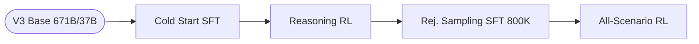

# 5.1 DeepSeek

!!! abstract "本节摘要"
    DeepSeek 用三篇报告把后训练变成一条独立的预算线：R1 让推理能力从纯 RL 中涌现（AIME 2024 39.2 → 79.8），V3 用 R1 蒸馏 + Self-Rewarding 把后训练压到预训练成本的 **0.18%**（5K H800 小时），V3.2 又用 8 域 Specialist Distillation 把预算抬到 **>10%**、AIME 2025 达 93.1。2026 年的 V4 / V4.1 把路线换成多教师全词表 OPD。

---

## 一、发布矩阵

| 模型 | 日期 | 规模 | 后训练要点 |
|---|---|---|---|
| **DeepSeek-V3** | 2024-12 | 671B / 37B | 双轨 SFT（R1 蒸馏 + V2.5 通用）→ GRPO → Self-Rewarding；RewardBench 87.0（maj@6 89.6） |
| **DeepSeek-R1** | 2025-01 | 671B / 37B | R1-Zero 纯 RL 涌现 → 四阶段精炼；AIME 2024 **79.8**；总训练 147K H800 小时 |
| R1-0528 / Prover-V2 | 2025-05 / 2025-04 | 同 R1 基座 | 更新 checkpoint；Prover-V2 转形式化定理证明 |
| **DeepSeek-V3.2** | 2025-12 | 671B / 37B + DSA | 8 域 Specialist Distillation + Mixed GRPO；AIME 2025 **93.1**，Speciale 96.0 |
| **DeepSeek-V4**（Pro / Flash，预览开源） | 2026-04-24 | 1.6T/49B、284B/13B | 领域专家独立 SFT+GRPO → **多教师全词表 OPD**（>10 教师，reverse KL）；**actor 兼任 GRM**，放弃标量 RM/RLHF |
| V4-Pro-0813（正式版） | 2026-08-13 | 同架构 | 只发 benchmark，**后训练改动未公开** |
| **V4.1-Flash** | 2026-09-10 | 552B（Causal Enc-Dec） | 明示"**不引入新后训练算法**"，OPD 教师扩到 **>40**，增益来自数据/环境合成 |

**R2 不存在**：官方 News 无 R2，网传"32B / AIME 92.7%"不可信。合并机制见 [3.3](../ch3/3.3-merging-opd-mopd.md)，奖励分层见 [1.4](../ch1/1.4-reward-lineage.md)。

## 二、后训练 Pipeline

### 2.1 R1：纯 RL 到四阶段

- **R1-Zero**：跳过 SFT 直接在 Base 上 GRPO，AIME 2024 达 **71.0**（Base 39.2）；自发出现 "Wait, let me reconsider" 式自我纠正与自我验证，反思词频涨 5–7 倍。代价是语言混杂、格式不稳——纯 RL 能涌现推理，但需要 SFT 兜格式与可读性。
- **Cold Start SFT**：数千条长 CoT（R1-Zero 过滤输出 + 人工精修），只做最小纠偏，保留 RL 探索空间。
- **Reasoning RL**：LR 3×10⁻⁶、G=16、max 65K tokens；671B 规模下 Critic 显存不可承受，故选 GRPO。
- **Rej. Sampling SFT**：800K 样本（数学 395K / 代码 211K / STEM 10K / 逻辑 10K / 通用 178K），**从 V3-Base 重训**而非继续训练，避免 RL 阶段引入的分布偏移。
- **All-Scenario RL**：偏好 RM 只看最终摘要，且仅用于最后 400/1700 步（更长暴露会 reward hacking）；安全 RM 用 106K 数据。

### 2.2 V3：蒸馏 + Self-Rewarding

- 双轨 SFT（~1.5M）：R1 蒸馏推理数据 + V2.5 通用数据；蒸馏样本有标准 `<problem,response>` 与 R1 风格 `<system_prompt,problem,R1_response>` 两种格式。
- 高温 RL 整合两种模式 → Rejection Sampling 取简洁高质量输出 → GRPO（规则 + 模型 RM）。
- 自身作 judge（Constitutional AI 思路）达 RewardBench 87.0，与 Claude-3.5-Sonnet 88.7、GPT-4o 86.7 相当。
- 成本：预训练 2,664K H800 小时 / $5.328M，**后训练仅 5K / $0.01M**。

### 2.3 V3.2：分域专家 + Mixed GRPO

- **Specialist Distillation**：8 个领域专家（数学 / 代码 / 科学 / 写作 / Agent 等）各自大规模 RL 后再蒸馏合并；与 V3 的"单一 R1 教师 + SFT"是两种范式。
- **Mixed GRPO**：一个阶段同时处理推理、Agent 与人类偏好对齐，替代 V3 的多段 RL。
- **V3.2-Speciale**：放松长度惩罚做长链推理，AIME 2025 **96.0**（通用 93.1）；通用版另有 IMO 2025 Gold（35/42）、IOI 2025 Gold（第 10）、ICPC WF 2025 Gold（第 2）。
- 架构未变，唯一新增是 **DSA**（在 V3 checkpoint 上续训约 946B tokens 适配），论文未再提 MTP。
- 后训练预算 **>10%** 预训练（V3 是 0.18%），计算量约 50 倍；官方结论 "RL scaling has not saturated"。

### 2.4 R1 蒸馏：蒸馏 >> 直接 RL

- 用 R1 生成的 804K 推理样本对小模型做纯 SFT（不做 RL）：R1-Distill-Qwen-32B 在 AIME 2024 达 **72.6**，而 Qwen2.5-32B 从头 RL（10K+ 步）只有 47.0，高出 **+25 分**。
- R1-Distill-Qwen-1.5B 达 **28.9**，超过 GPT-4o 的 9.3——大教师的推理模式通过 SFT 迁移，比小模型自己 RL 发现高效得多。
- 报告提到"在蒸馏模型上继续 RL 会显著提升"，但留给社区；这成为 V3 之后各家 strong-to-weak 路线的起点。

## 三、关键工程点

1. **GRPO 的四项稳定化**（V3.2 报告）：无偏 KL 估计替代有偏的 K3 估计器；对"负优势且 KL 偏离大"的序列整体 mask；**Keep Routing** 保留采样时的 MoE 路由（自 V3-0324 起）；**Keep Sampling Mask** 保留采样截断掩码。前两项修梯度噪声，后两项修训推不一致（见 [4.3](../ch4/4.3-infra-consistency.md)）。
2. **预算结构本身就是方法论**：V3 的 5K GPU 小时能成立，前提是有 R1 这个强教师；V3.2 把预算拉高约 50 倍后 AIME 从 39.2 到 93.1——蒸馏的边际收益见顶后，预算要转投 RL scaling。
3. **MTP 只服务推理**：V3 训练 D=1 的 MTP 模块用于投机解码，接受率 85–90%、**1.8× TPS**，训练后即可丢弃（损失权重 λ 从 0.3 降到 0.1）。

## 四、失败经验

- **PRM 不如 ORM**：中间步骤难精确标注，大规模 RL 下 reward hacking 不可避免，重训 PRM 只增加复杂度。
- **MCTS 在 LLM 上不 work**：token 级搜索空间指数增长、value 估计不准，AlphaGo 式自举未复现。
- **直接 Base RL 不可用**：R1-Zero 能力涌现但语言混杂、可读性差，必须补 SFT。
- **V3.2 的局限**：Speciale 的 token 消耗是 Gemini-3.0-Pro 的 2–3 倍；长 Agent 任务会溢出 128K 上下文；IMO 2025 最难题 P6 得 0；数学域可从弱 KL 中受益，其他域需要更强的 KL 约束。

## 五、2026 变化

- 路线从"单教师蒸馏"转为"**多教师全词表 OPD**"：V4 用 >10 个教师（reverse KL），V4.1-Flash 扩到 >40，并明示不引入新算法——增益来自数据与环境合成（[4.1](../ch4/4.1-data-engineering.md) / [4.2](../ch4/4.2-environment.md)）。
- **actor 兼任 GRM**：放弃标量 RM / RLHF，把生成模型本身当奖励来源；奖励谱系见 [1.4](../ch1/1.4-reward-lineage.md)。
- V4-Pro-0813 只发 benchmark，后训练改动未公开。

## 参考资料

- **R1**：[2501.12948](https://arxiv.org/abs/2501.12948)（2025.01）
- **V3**：[2412.19437](https://arxiv.org/abs/2412.19437)（2024.12）
- **V3.2**：[2512.02556](https://arxiv.org/abs/2512.02556)（2025.12）
- **Prover-V2**：[2504.21801](https://arxiv.org/abs/2504.21801)
- **相关章节**：[1.4 奖励谱系](../ch1/1.4-reward-lineage.md) · [3.3 合并与 OPD](../ch3/3.3-merging-opd-mopd.md) · [4.3 训推一致性](../ch4/4.3-infra-consistency.md) · [6.2 跨模型对比](../ch6/6.2-evolution.md)
