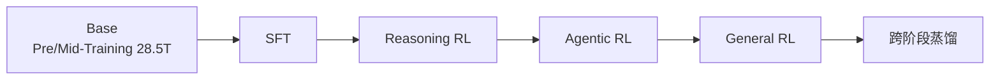

# 5.5 GLM

!!! abstract "本节摘要"
    GLM-5 提供了 Agentic RL 工程细节最丰富的公开报告：五阶段顺序训练、TITO 防 re-tokenization 不一致、CUDA 非确定性 top-k 导致的训练崩溃、异步 Slime 框架（1K+ 并发 rollout），以及用跨阶段蒸馏解决多阶段遗忘，SWE-bench Verified 达 **77.8%**。2026 年的 GLM-5.3 又给出"同基座、只做后训练 scaling"的干净对照。

---

## 一、发布矩阵

| 模型 | 日期 | 规模 | 后训练要点 |
|---|---|---|---|
| **GLM-5** | 2026-02 | 744B / 40B，28.5T 预训练 | 五阶段（SFT → Reasoning RL → Agentic RL → General RL → 跨阶段蒸馏）；SWE 77.8 / BrowseComp 75.9 |
| GLM-5.1 | 2026-04-08 | 未公开 | 单次任务 8 小时持续工作；长程训练窗口扩展 + tool use 专项 |
| **GLM-5.2** | 2026-06-16 | 未公开，1M ctx | 新增 **IndexShare**（每 4 层复用索引器）；后训练细节**仅二手**（并行 OPD、critic-based PPO） |
| **GLM-5.3** | 2026-08-14 | 同 5.2 基座（743B/40B） | **纯后训练 scaling**：环境合成 + verifier 三检 + **SAO** + 多教师 OPD；TB3.0 4.6 → 28.3 |

口径：**GLM-6 不存在**；GLM-5.2 官方未公布参数量。GLM-5.3 是"同基座、只做后训练"的最干净公开对照。

架构上 GLM-5 是 744B/40B MoE（256 专家、75 个 MoE 层），注意力用 MLA + DeepSeek Sparse Attention（DSA），预训练 28.5T tokens——是除 DeepSeek 自身外首个详细描述 DSA 集成经验的模型。

## 二、训练全流程（GLM-5）

- **Base**：Pre-Training 覆盖 Web / Code / Math & Science，目标是 ARC（Agentic, Reasoning, Coding）统一模型而非聊天模型；Mid-Training 定向补三项——长上下文分阶扩展（4K → 32K/1T → 128K/500B → 200K/50B）、Agent 长上下文数据、软件工程建模（repo code / commit diff / issue / PR 串成同一序列，约 **160B** tokens）。
- **SFT**：General Chat / Reasoning / Coding & Agent 三类数据，并提前注入三种 thinking 行为——**Interleaved**（每次回复与每次 tool call 前都思考）、**Preserved**（跨轮保留推理历史）、**Turn-level**（按轮控制是否推理）。
- **Reasoning RL**：数学 / 科学 / 代码 / TIR 四个方向，标准 RLVR（0/1 奖励）；先修推理，因为工具调用与任务规划都建在推理链之上。
- **Agentic RL**：SWE / Terminal / Search 三类可验证环境；rollout 轨迹 y = (r₁,a₁,o₁,…,rₙ,aₙ,oₙ)，r 为 thinking、a 为 tool call、o 为 observation；环境打分后用组内相对优势 A(x,yᵢ) = r(x,yᵢ) − r̄(x) 做 group-wise 优化。
- **General RL**：优化基础正确性、交流体验与单项任务质量，hybrid reward（rule-based + ORM + GRM），并引入高质量人工答案作风格锚点，避免"AI 味"自循环。
- **跨阶段蒸馏（OPD）**：各阶段最优 checkpoint 都当 teacher，student 在 teacher 训练集上 on-policy 采样，token 级优势 Â_t = sg[log π_teacher − log π_student]（**group size=1**，优势来自 teacher 而非组内相对比较）；teacher 高 / student 低则为正优势。机制与 MOPD 见 [3.3](../ch3/3.3-merging-opd-mopd.md)。

## 三、关键工程点

1. **TITO Gateway**：推理引擎直接输出 token IDs、训练引擎跳过重新 tokenize。即使 0.1% 的 token 不一致，也会让 log-prob 序列错位、优势估计偏移，累积数千步后表现为"训练收敛但最终效果远低于预期"。
2. **非确定性 CUDA top-k**：DSA 用 top-k（k=2048）选 key token，CUDA/TileLang 实现在大 k 下不保证确定性。RL 要在 rollout 与 train 对同一序列各前向一次，两次 attention 模式不同 → log-prob 不一致 → 梯度方向错误 → 熵激增 → 几步内崩溃。修复是换 `torch.topk` 确定性实现；所有 top-k 类算子（含 MoE 路由）都应照此处理。
3. **异步 Slime**：Multi-Task Rollout Orchestrator 管 **1K+** 并发 rollout，异步 rollout-train 不等全量完成，KL 约束用 IcePop；与 MiniMax Forge 的 Windowed FIFO 路线不同（未做前缀合并）。一致性视角见 [4.3](../ch4/4.3-infra-consistency.md)。

## 四、失败经验

- **re-tokenization 是沉默 bug**：不报错、不 NaN，只是持续引入微小梯度偏差。
- **预训练里无所谓的非确定性，在 RL 里致命**：前向差异会被数据平均掉，却会被策略梯度放大成错误方向。
- **多阶段必遗忘**：Agentic RL 会冲掉 Reasoning RL，General RL 又冲掉前两个阶段——跨阶段蒸馏是补丁，也说明顺序 RL 本身不稳。
- GLM-5 另在 7 个国产芯片平台做了适配，属独有工程信息，但不涉及后训练算法。

## 五、2026 变化

- **GLM-5.3 是 2026 年最有说服力的材料**：基座不动，纯后训练 scaling（环境合成 + verifier 三检 + SAO + 多教师 OPD）把 TB3.0 从 4.6 拉到 **28.3**；验证器失败模式见 [4.4](../ch4/4.4-verifier-failures.md)，环境合成见 [4.2](../ch4/4.2-environment.md)。
- 5.1 把训练窗口拉到 8 小时级任务，5.2 用 IndexShare 降长上下文成本——后训练与架构、推理的耦合在加深。
- 注意：GLM-5.2 的后训练细节官方未发布，不要当成结论。

## 参考资料

- **GLM-5**：[2602.15763](https://arxiv.org/abs/2602.15763)（2026.02）
- **相关章节**：[2.7 信任域](../ch2/2.7-trust-region-2026.md) · [3.3 合并与 OPD](../ch3/3.3-merging-opd-mopd.md) · [4.3 训推一致性](../ch4/4.3-infra-consistency.md) · [4.4 验证器失败](../ch4/4.4-verifier-failures.md)
