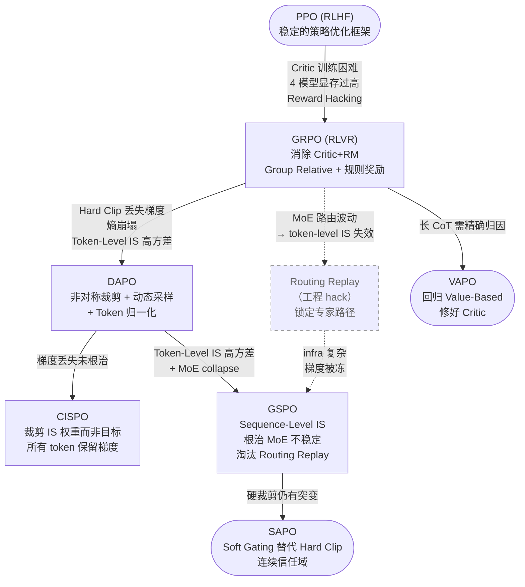
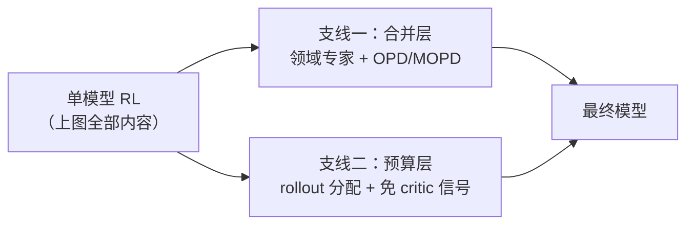

# 6.2 演进与对比

!!! abstract "本节摘要"
    两条线索并置：纵向是 2017–2026 的时间线与五代范式变迁；横向是 2025 与 2026 两套对比口径——前者看阶段数/算法/Critic，后者看合并方式/一致性/异步策略。

---

## 一、演进时间线

时间线覆盖 2017.07–2026.11。2026 年分成两段：前段是 Agentic RL 论文井喷，后段是"专家+合并 / 同基座后训练 scaling"的新阶段。

```mermaid
timeline
    title Post-Training 技术演进时间线
    section 2017-2022 奠基
        2017.07 : PPO 发布 (Schulman et al.)
                : 奠定策略优化基础框架
        2022.03 : InstructGPT 发布 (OpenAI)
                : 确立 SFT → RM → RLHF 三阶段范式
                : 证明 1.3B RLHF > 175B Base
        2022.12 : Constitutional AI (Anthropic)
                : 提出 RLAIF, 用 AI 反馈替代人类反馈
    section 2023-2024 分化
        2023.05 : DPO 发布 (Stanford)
                : 绕过 RM, 直接从偏好数据优化策略
        2024.02 : DeepSeekMath → GRPO
                : 消除 Critic, Group Relative 优势
        2024.07 : LLaMA 3.1 (Meta)
                : 6 轮迭代训练, 工业级最详尽报告
        2024.12 : DeepSeek-V3 / Qwen2.5
                : R1 蒸馏 pipeline / 6 维 RM
    section 2025 RLVR 爆发
        2025.01 : DeepSeek-R1 ★★★
                : 纯 RL 推理涌现, RLVR 范式确立
        2025.03 : DAPO (ByteDance Seed)
                : 首个完全开源大规模 RL 系统
        2025.04 : VAPO / Seed1.5-Thinking
                : 回归 Value-Based, 修好 Critic
        2025.05 : Qwen3
                : Thinking Mode Fusion
        2025.06 : CISPO (MiniMax-M1)
                : 裁剪 IS 权重而非目标函数
        2025.07 : GSPO / Kimi K2
                : Sequence-Level + 3000 MCP 工具
        2025.11 : SAPO (Qwen Team)
                : Soft Gating 统一理论框架
    section 2026 Agentic RL
        2026.02 : GLM-5 (智谱)
                : 五阶段全能 pipeline
        2026.03 : Agentic RL 论文井喷
                : SeeUPO, EMPO², ARLArena
    section 2026 后训练新阶段
        2026.04 : DeepSeek-V4
                : 多教师 OPD + actor 兼任 GRM
        2026.06 : MiniMax M3 / MSA
                : 1M 上下文块稀疏注意力
        2026.06 : LongCat-2.0
                : 多教师在线蒸馏 + MOPD
        2026.07 : Kimi K3
                : 9 专家 + MOPD + 全流程 QAT
        2026.08 : GLM-5.3
                : 同基座纯后训练 scaling (TB3.0 4.6→28.3)
        2026.11 : LongCat-2.5 / Qwen4-Max
                : 1.6T 国产算力 / 2.4T-71B
```



注意 2026 年的条目：交互形态（Agentic RL）、合并方式（OPD/MOPD）、scaling 对象（同基座）三件事，没有一件是新的损失函数。

## 二、五代范式

每一代的 pipeline 与核心矛盾如下。算法细节见 [2.1 PPO](../ch2/2.1-ppo.md) 起的第 2 章，合并机制见 [3.3](../ch3/3.3-merging-opd-mopd.md)。

=== "第一代：SFT-Only (2020-2022)"

    ```
    Base Model → SFT → Deploy
    ```

    - **代表**: 早期的 Alpaca, Vicuna
    - **核心思路**: 用高质量对话数据直接微调
    - **局限**: 模型只会模仿，不会"判断好坏"

=== "第二代：RLHF (2022-2024)"

    ```
    Base → SFT → RM Training → PPO/DPO → Deploy
    ```

    - **代表**: InstructGPT, ChatGPT, Claude, LLaMA 2
    - **核心思路**: 用人类偏好训练奖励模型，再用 RL 优化
    - **突破**: 模型学会了"什么是更好的回答"
    - **局限**: RM 容易被 hack，pipeline 复杂，对推理提升有限

=== "第三代：RLVR + Reasoning RL (2025)"

    ```
    Base → Cold Start SFT → Reasoning RL (GRPO/DAPO/VAPO) → General RL → Deploy
    ```

    - **代表**: DeepSeek-R1, Qwen3, QwQ
    - **核心思路**: 用可验证的规则奖励（答案对错）直接训练推理能力
    - **突破**: 推理能力从 RL 中涌现，不再依赖标注数据
    - **局限**: 只适用于有确定答案的任务

=== "第四代：Agentic RL (2025-2026)"

    ```
    Base → SFT → Reasoning RL → Agentic RL → General RL → Deploy
    ```

    - **代表**: GLM-5, Kimi K2, 以及 2026 Q1 的研究论文
    - **核心思路**: 将 RL 扩展到多轮交互、工具使用、环境感知等复杂场景
    - **挑战**: 奖励信号更稀疏、信用分配更困难、探索空间更大

=== "第五代：专家+合并 (2026)"

    ```
    域1 SFT+RL → 专家1 ┐
    域2 SFT+RL → 专家2 ┼→ OPD/MOPD 合并 → Deploy
    域3 SFT+RL → 专家3 ┘
    ```

    - **代表**: DeepSeek-V4（>10 → >40 教师）、Kimi K3（9 专家 + MOPD）、LongCat-2.0、GLM-5 的跨阶段蒸馏
    - **核心思路**: 承认"一个模型同时精通所有域"不现实——先分别训专家，再用**在策略蒸馏**合并
    - **突破**: 绕开多目标干扰与能力遗忘；合并阶段用学生自己采样，避免 SFT 蒸馏的 exposure bias
    - **挑战**: 教师数量带来调度/显存/带宽成本；教师会把自身坏习惯蒸进学生；合并后通常不再继续 RL

驱动力可以压成一句：**标注成本**（人类偏好 → AI 偏好 → 规则）、**Reward Hacking**（神经 RM → 多维 RM → 规则）、**推理与 Agent 需求**、**算法效率**（PPO 4 模型 → GRPO 3 模型 → DPO 无 RL）。

## 三、演进图与两条新支线

先看"单模型内换目标函数"的完整历史：



!!! note "图中的两条主线"
    - **Token-level 细化线**：GRPO → DAPO → CISPO → SAPO，在 token 粒度上分别修补探索、梯度与边界。
    - **粒度跃迁线**：GRPO → GSPO，直接换优化粒度，让 IS 在 MoE 上重新 well-defined。

    两条线在 SAPO 处汇合：SAPO 在 token 级定义 soft gate，理论上自动逼近 sequence-level——可以理解为 GSPO 思路的 token 级软实现。

2026 年出现了这张图没有覆盖的两条支线：



- **合并层**（[3.3](../ch3/3.3-merging-opd-mopd.md)）：先训多个领域专家，再用在策略蒸馏合并——DeepSeek（>10 → >40 教师）、Kimi K3（9 专家 + MOPD）、GLM-5（跨阶段蒸馏）、LongCat 2.0。
- **预算层**（[3.1](../ch3/3.1-rollout-allocation.md)、[3.2](../ch3/3.2-dense-signal.md)）：rollout 分配（Pilot-Commit / ReMix / PCL / SAO）与免 critic 的稠密信号（Progress Advantage / SDPO）。

这两条支线解释了 2026 年的一个反直觉现象：**头部厂商公开说"没有新算法"，但效果仍在快速提升**——提升来自合并与预算，而不是损失函数。

!!! warning "一个 2026 年的修正"
    图里的 Routing Replay 曾被 GSPO 判为死分支。2026 年 R3 让它以"一致性手段"的身份回归，并在 MoE 上优于 GSPO/TIS——死分支复活，说明"一致性优先于目标函数"（[4.3](../ch4/4.3-infra-consistency.md)）。同时，SAPO 也不再是终点：DPPO / TRM / LPO 把信任域问题从"clip 形状"换成了"约束什么量、在哪一层"（[2.7](../ch2/2.7-trust-region-2026.md)）。

## 四、2025 与 2026 的对比维度

### 2025 口径：阶段、算法、Critic

| 模型 | 阶段数 | Pipeline 结构 | RL 算法 | Value 网络 |
|------|--------|-------------|---------|-----------|
| DeepSeek-R1 | 4 | Cold SFT → Reasoning RL → Rej.Sampling SFT → General RL | **GRPO** | 无 |
| DeepSeek-V3.2 | 3 | Specialist Distillation → Mixed RL → Speciale（推理变体） | **GRPO**（4 项稳定化） | 无 |
| Kimi K2 | ~3 | SFT → Agentic RL（RLVR + Self-Critique） | Policy Mirror Descent | 无 |
| Kimi K2.5 | ~3 | SFT → RL + Toggle + PARL | Policy Mirror Descent | 无 |
| Qwen3 | 4 | Cold SFT → Reasoning RL → Mode Fusion SFT → General RL | **GRPO** | 无 |
| MiniMax-01 | 5 | Short SFT → Long SFT → Short DPO → Long DPO → RL | GRPO（修改版） | 无 |
| MiniMax-M1 | 3 | CPT → SFT → RL | **CISPO** | 无 |
| GLM-5 | 5 | SFT → Reasoning RL → Agentic RL → General RL → Distillation | GRPO + IcePop | 无 |
| Seed/VAPO | 2-3 | (Cold SFT →) RL | **VAPO（PPO 改）** | **有** |

这张表在 2025 年能解释大部分差异：阶段数反映 pipeline 复杂度，算法决定稳定性，Value 网络决定信用分配精度。9 行覆盖 6 家、2–5 个阶段档位——最长的是 MiniMax-01 与 GLM-5，最简的是 Seed/VAPO。

但阶段数与能力没有单调关系：DeepSeek-R1 用 4 段把推理 RL 做成主线，Seed/VAPO 只用 2–3 段也在 AIME 上领先。决定效果的是每段"目标是否单一"，而不是段数本身。

### 2026 口径：合并、一致性、异步

所有人在算法上都收敛到 GRPO 变体，阶段数稳定在 3–5 段，Value 网络几乎消失。差异换到了另外三列：

| 模型 | 合并方式 | 一致性手段 | 异步策略 |
|---|---|---|---|
| **DeepSeek-V4 / V4.1** | 多教师全词表 OPD（>10 → >40 教师） | 未公开 | 异步 RL |
| **Kimi K3** | 9 专家（3 域 × 3 effort）+ **MOPD** | **全流程 QAT**（MXFP4/MXFP8） | partial rollout + 微虚机 |
| **GLM-5 / 5.3** | 跨阶段蒸馏 + 多教师 OPD | **TITO** + 确定性 top-k + 双侧 IS | 全异步（Slime） |
| **MiniMax M2.5** | 无（混合域训练） | 前缀树合并 + PD 分离 | Forge（Windowed FIFO） |
| **LongCat 2.0 / 2.5** | 多教师在线蒸馏 + MOPD | W4A4 数值一致 | DORA（load ratio 63%） |
| **Ling / Ring 2.6** | 无（迁移预训练 + LPO） | FP8 + LM head FP32 | ASystem（partial + 有界 stale） |
| **Qwen3.5 / 4-Max** | 跨模态 OPD（Omni） | TRACE（FP4 对齐） | QwenGyre（弹性 GPU） |

**读法**：算法列（GRPO/GSPO/SAPO）已经不能解释差异了——**合并方式决定能力上限，一致性手段决定能不能跑起来，异步策略决定成本**。这三列才是 2026 年的胜负手。

这也解释了 6.1 的披露收缩：算法可以一句话带过，而合并、一致性、异步恰恰是厂商最不愿公开的三类细节（[6.1](./6.1-overview-2026.md)）。

奖励设计对比不在本节展开，见 [1.4](../ch1/1.4-reward-lineage.md)；单模型内的算法演进图见 [6.3](./6.2-evolution.md)。
