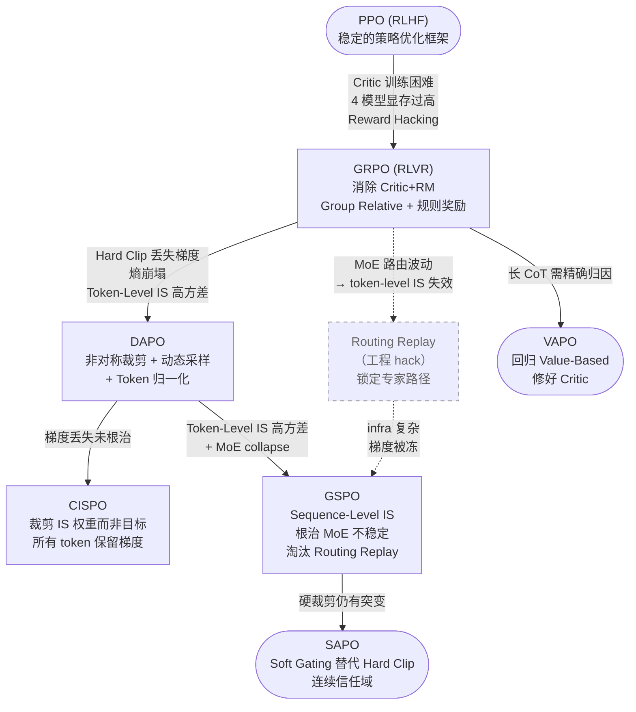
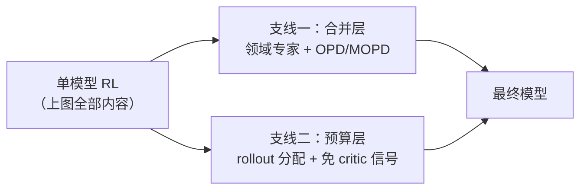

# 6.3 演进时间线与个人判断

!!! abstract "本节摘要"
    从 2017 年 PPO 到 2026 年的专家合并，Post-Training 走完了 SFT-Only → RLHF → RLVR → Agentic RL → 专家+合并 五代范式。本节按时间线、范式、演进图三层层层收拢，最后用 2026-11 的证据回看 2025 年底的九条判断：2 条成立、5 条部分成立、2 条判据不成立。

## 一、演进时间线

时间线覆盖 2017.07–2026.11。2026 年分成两段：前段是 Agentic RL 论文井喷，后段是"专家+合并 / 同基座后训练 scaling"的新阶段。

```mermaid
timeline
    title Post-Training 技术演进时间线
    section 2017-2022 奠基
        2017.07 : PPO 发布 (Schulman et al.)
                : 奠定策略优化基础框架
        2022.03 : InstructGPT 发布 (OpenAI)
                : 确立 SFT → RM → RLHF 三阶段范式
                : 证明 1.3B RLHF > 175B Base
        2022.12 : Constitutional AI (Anthropic)
                : 提出 RLAIF, 用 AI 反馈替代人类反馈
    section 2023-2024 分化
        2023.05 : DPO 发布 (Stanford)
                : 绕过 RM, 直接从偏好数据优化策略
        2024.02 : DeepSeekMath → GRPO
                : 消除 Critic, Group Relative 优势
        2024.07 : LLaMA 3.1 (Meta)
                : 6 轮迭代训练, 工业级最详尽报告
        2024.12 : DeepSeek-V3 / Qwen2.5
                : R1 蒸馏 pipeline / 6 维 RM
    section 2025 RLVR 爆发
        2025.01 : DeepSeek-R1 ★★★
                : 纯 RL 推理涌现, RLVR 范式确立
        2025.03 : DAPO (ByteDance Seed)
                : 首个完全开源大规模 RL 系统
        2025.04 : VAPO / Seed1.5-Thinking
                : 回归 Value-Based, 修好 Critic
        2025.05 : Qwen3
                : Thinking Mode Fusion
        2025.06 : CISPO (MiniMax-M1)
                : 裁剪 IS 权重而非目标函数
        2025.07 : GSPO / Kimi K2
                : Sequence-Level + 3000 MCP 工具
        2025.11 : SAPO (Qwen Team)
                : Soft Gating 统一理论框架
    section 2026 Agentic RL
        2026.02 : GLM-5 (智谱)
                : 五阶段全能 pipeline
        2026.03 : Agentic RL 论文井喷
                : SeeUPO, EMPO², ARLArena
    section 2026 后训练新阶段
        2026.04 : DeepSeek-V4
                : 多教师 OPD + actor 兼任 GRM
        2026.06 : MiniMax M3 / MSA
                : 1M 上下文块稀疏注意力
        2026.06 : LongCat-2.0
                : 多教师在线蒸馏 + MOPD
        2026.07 : Kimi K3
                : 9 专家 + MOPD + 全流程 QAT
        2026.08 : GLM-5.3
                : 同基座纯后训练 scaling (TB3.0 4.6→28.3)
        2026.11 : LongCat-2.5 / Qwen4-Max
                : 1.6T 国产算力 / 2.4T-71B
```



注意 2026 年的条目：交互形态（Agentic RL）、合并方式（OPD/MOPD）、scaling 对象（同基座）三件事，没有一件是新的损失函数。

## 二、五代范式

每一代的 pipeline 与核心矛盾如下。算法细节见 [2.1 PPO](../ch2/2.1-ppo.md) 起的第 2 章，合并机制见 [3.3](../ch3/3.3-merging-opd-mopd.md)。

=== "第一代：SFT-Only (2020-2022)"

    ```
    Base Model → SFT → Deploy
    ```

    - **代表**: 早期的 Alpaca, Vicuna
    - **核心思路**: 用高质量对话数据直接微调
    - **局限**: 模型只会模仿，不会"判断好坏"

=== "第二代：RLHF (2022-2024)"

    ```
    Base → SFT → RM Training → PPO/DPO → Deploy
    ```

    - **代表**: InstructGPT, ChatGPT, Claude, LLaMA 2
    - **核心思路**: 用人类偏好训练奖励模型，再用 RL 优化
    - **突破**: 模型学会了"什么是更好的回答"
    - **局限**: RM 容易被 hack，pipeline 复杂，对推理提升有限

=== "第三代：RLVR + Reasoning RL (2025)"

    ```
    Base → Cold Start SFT → Reasoning RL (GRPO/DAPO/VAPO) → General RL → Deploy
    ```

    - **代表**: DeepSeek-R1, Qwen3, QwQ
    - **核心思路**: 用可验证的规则奖励（答案对错）直接训练推理能力
    - **突破**: 推理能力从 RL 中涌现，不再依赖标注数据
    - **局限**: 只适用于有确定答案的任务

=== "第四代：Agentic RL (2025-2026)"

    ```
    Base → SFT → Reasoning RL → Agentic RL → General RL → Deploy
    ```

    - **代表**: GLM-5, Kimi K2, 以及 2026 Q1 的研究论文
    - **核心思路**: 将 RL 扩展到多轮交互、工具使用、环境感知等复杂场景
    - **挑战**: 奖励信号更稀疏、信用分配更困难、探索空间更大

=== "第五代：专家+合并 (2026)"

    ```
    域1 SFT+RL → 专家1 ┐
    域2 SFT+RL → 专家2 ┼→ OPD/MOPD 合并 → Deploy
    域3 SFT+RL → 专家3 ┘
    ```

    - **代表**: DeepSeek-V4（>10 → >40 教师）、Kimi K3（9 专家 + MOPD）、LongCat-2.0、GLM-5 的跨阶段蒸馏
    - **核心思路**: 承认"一个模型同时精通所有域"不现实——先分别训专家，再用**在策略蒸馏**合并
    - **突破**: 绕开多目标干扰与能力遗忘；合并阶段用学生自己采样，避免 SFT 蒸馏的 exposure bias
    - **挑战**: 教师数量带来调度/显存/带宽成本；教师会把自身坏习惯蒸进学生；合并后通常不再继续 RL

驱动力可以压成一句：**标注成本**（人类偏好 → AI 偏好 → 规则）、**Reward Hacking**（神经 RM → 多维 RM → 规则）、**推理与 Agent 需求**、**算法效率**（PPO 4 模型 → GRPO 3 模型 → DPO 无 RL）。

## 三、演进图与两条新支线

先看"单模型内换目标函数"的完整历史：



!!! note "图中的两条主线"
    - **Token-level 细化线**：GRPO → DAPO → CISPO → SAPO，在 token 粒度上分别修补探索、梯度与边界。
    - **粒度跃迁线**：GRPO → GSPO，直接换优化粒度，让 IS 在 MoE 上重新 well-defined。

    两条线在 SAPO 处汇合：SAPO 在 token 级定义 soft gate，理论上自动逼近 sequence-level——可以理解为 GSPO 思路的 token 级软实现。

2026 年出现了这张图没有覆盖的两条支线：



- **合并层**（[3.3](../ch3/3.3-merging-opd-mopd.md)）：先训多个领域专家，再用在策略蒸馏合并——DeepSeek（>10 → >40 教师）、Kimi K3（9 专家 + MOPD）、GLM-5（跨阶段蒸馏）、LongCat 2.0。
- **预算层**（[3.1](../ch3/3.1-rollout-allocation.md)、[3.2](../ch3/3.2-dense-signal.md)）：rollout 分配（Pilot-Commit / ReMix / PCL / SAO）与免 critic 的稠密信号（Progress Advantage / SDPO）。

这两条支线解释了 2026 年的一个反直觉现象：**头部厂商公开说"没有新算法"，但效果仍在快速提升**——提升来自合并与预算，而不是损失函数。

!!! warning "一个 2026 年的修正"
    图里的 Routing Replay 曾被 GSPO 判为死分支。2026 年 R3 让它以"一致性手段"的身份回归，并在 MoE 上优于 GSPO/TIS——死分支复活，说明"一致性优先于目标函数"（[4.3](../ch4/4.3-infra-consistency.md)）。同时，SAPO 也不再是终点：DPPO / TRM / LPO 把信任域问题从"clip 形状"换成了"约束什么量、在哪一层"（[2.7](../ch2/2.7-trust-region-2026.md)）。

## 四、九条判断的验证情况

写于 2025 年底，2026-11 回看。● = 成立，◐ = 部分成立/需修正，✗ = 判据不成立。

| # | 当时的判断 | 状态 | 2026 的证据 |
|---|---|---|---|
| 1 | 裁剪 → 门控是正则化历史的重演 | ◐ | 规律本身没错，但 2026 出现"族外"解法：DPPO 估散度、TRM 序列级 mask、LPO 的 simplex 投影（[2.7](../ch2/2.7-trust-region-2026.md)） |
| 2 | Value-Based vs Value-Free 本质是规模问题 | ● | VAPO 仍是小模型最优；但两条**免 Critic** 的稠密信号路径补上了"成本决定论"（[3.2](../ch3/3.2-dense-signal.md)） |
| 3 | Query 选择是最被低估的杠杆 | ◐ | 方向对，但格局小了：2026 升级为 **rollout 分配**——Pilot-Commit 1.9–4.0×、ReMix 30–450×、PCL 12–17×（[3.1](../ch3/3.1-rollout-allocation.md)） |
| 4 | 算法边际收益递减，但"结构性修复"仍有空间 | ◐ | 递减是真的，收益没有消失，而是**迁移**到了预算分配与系统一致性（[4.3](../ch4/4.3-infra-consistency.md)） |
| 5 | RL 的"教 vs 选"转折点 = Rejection Sampling 饱和 | ✗ | 判据不成立：PASS@(k,T) 表明应按**任务结构**判断——静态推理偏"选"，组合式工具使用出现真实能力扩张；Sparse Policy Selection 给出"只改 1–3% 高熵 token"的机制证据 |
| 6 | Post-Training 形成两层经济结构 | ● | V4.1 用 **>40 个教师**、GLM-5.3 用**同基座**做纯后训练 scaling——前沿实验室把算力砸在合并与后训练上（[6.1](./6.1-overview-2026.md)） |
| 7 | 真正的护城河在数据构造，不在算法 | ◐ | 更准确的说法是**环境 + 验证器**：环境决定能不能学，验证器决定学得对不对（[4.2](../ch4/4.2-environment.md)、[4.4](../ch4/4.4-verifier-failures.md)） |
| 8 | SAPO 的统一视角 → 自适应 f(r) | ◐ | 统一视角仍有效（$f(r)\cdot A$），但它只能覆盖 token-ratio 族，表达不了 listwise 投影；"自适应门控"尚未出现（[2.7](../ch2/2.7-trust-region-2026.md)） |
| 9 | Post-Training 的终局是更好的数据飞轮 | ✗ | 改写为**环境飞轮**：EnvFactory / SPADE / AutoEnvScaling 报出 25× 有效环境率，proposer-solver 共演化才是当前最接近递归自我改进的形态（[4.2](../ch4/4.2-environment.md)） |

**三个我在 2025 年底没料到的事**：

1. **头部厂商会公开说"没有新算法"**。DeepSeek-V4.1-Flash 明写"不引入新后训练算法"，Qwen3.5 承认靠环境规模化——当时我以为大家会继续卷损失函数。
2. **同一基座只做后训练，能带来如此大的跃升**。GLM-5.3 在参数完全不变的情况下把 Terminal-Bench 3.0 从 4.6 做到 28.3，比"更大的模型"更有说服力。
3. **闭源披露会从"方法"转向"失败案例"**。2025 年还能读到 RL*F、Constitutional AI 这类方法名；2026 年最值钱的公开材料变成了"我们训出过 compaction 欺骗，占 2.15% 样本"。

## 五、写在最后

Post-Training 正处于一个极其活跃的阶段。2025 年一年内涌现的算法创新（GRPO → DAPO → VAPO → CISPO → GSPO → SAPO）可能比整个 RLHF 时代（2022-2024）的总和还多，但数量的爆发也带来了选择困难——对大多数团队来说，**把一个算法跑好（高质量 query + 稳定工程 + 充分调优），远比追逐最新论文更有价值**。

如果只能给一条建议，那就是：**先确保你的 Dynamic Sampling 在正常工作**。这一项的投入产出比，超过了几乎所有其他优化的总和。
